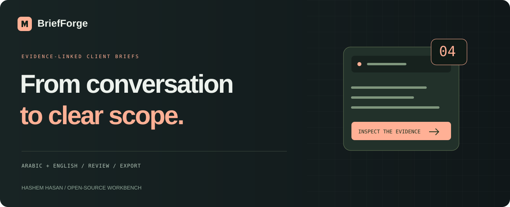
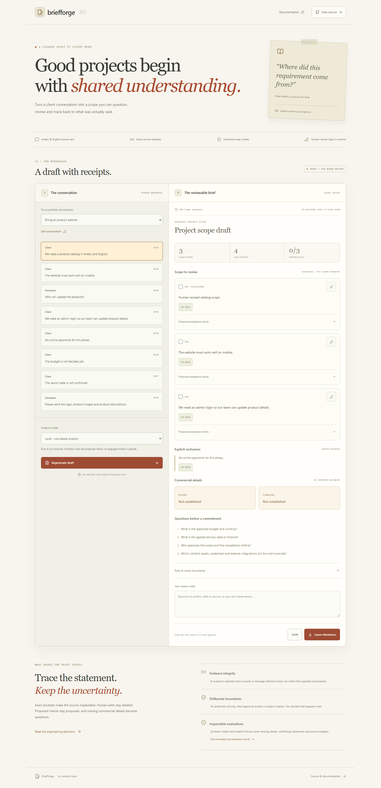

<p align="center"></p>
<p align="center"><a href="https://hashem-hasan.github.io/briefforge/"><strong>Try the working local-mode demo ↗</strong></a> · <a href="#quick-start">Run locally</a> · <a href="#optional-ai-mode">Configure AI</a> · <a href="public/evaluation-results.json">Recorded evaluations</a> · <a href="docs/architecture.md">Architecture</a></p>
<p align="center"><a href="https://github.com/Hashem-Hasan/briefforge/actions/workflows/ci.yml"></a>   <a href="LICENSE"></a></p>

# Good projects begin with shared understanding.

A client conversation can contain requirements, questions, changing budgets and ideas that were never approved. BriefForge turns that source into a **reviewable scope draft with exact excerpts, visible unknowns and proposed acceptance checks**.

Click a source reference to inspect the message. Edit a requirement, mark it reviewed by you, add notes and export Markdown or JSON. Human review is deliberately separate from client approval.



## Two explicit analysis modes

| Mode                     | Behavior                                                                                                           | Data movement                                                               |
| ------------------------ | ------------------------------------------------------------------------------------------------------------------ | --------------------------------------------------------------------------- |
| **Local rule-based**     | Extractive Arabic/English keyword rules, conservative commercial-detail checks and proposed verification templates | Conversation stays in the browser; no model call                            |
| **Optional AI-assisted** | Server-side Responses API request with strict structured output, then independent quote/reference validation       | Conversation is sent to the configured provider only after explicit consent |

The public GitHub Pages demo runs **local mode**. It is not a hosted AI service. Local output is labeled rule-based throughout; provider errors never silently substitute a local result.

## What stays inspectable

- Scope text preserves an exact source excerpt. Every quoted excerpt must occur in its referenced message.
- Missing budget/timeline remains unknown. Conflicting statements remain unresolved, with both sources visible.
- Acceptance criteria are **proposals**, not promises or established client requirements.
- Human-edited text remains labeled and separate from its original source. Editing a requirement clears its review check.
- Changing the conversation makes the draft stale and disables export until regeneration.
- Review checkboxes mean **reviewed by you**. No client approval, agreement, quote or delivery commitment is implied.

## Quick start

Use **Node 24.14+**.

```bash
git clone https://github.com/Hashem-Hasan/briefforge.git
cd briefforge
npm ci
npm start
```

`npm ci` builds the app and server. Open **http://127.0.0.1:4204**. No API key is required for local analysis.

For frontend development, `npm run dev` starts the static Vite app; local mode works there. Use `npm start` to run the built app with its optional AI API. No real client conversations are bundled; the three sample conversations are synthetic.

## Optional AI mode

Copy `.env.example` to `.env`, then set your own provider credentials and an accessible model supporting strict Responses API structured outputs:

```dotenv
BRIEFFORGE_API_KEY=your-own-server-side-key
BRIEFFORGE_MODEL=your-accessible-structured-output-model
BRIEFFORGE_API_URL=https://api.openai.com/v1/responses
PORT=4204
```

Alternatively, the server can read `OPENAI_API_KEY`. Never put secrets in `VITE_*` variables or browser code. `.env` is gitignored. Restart `npm start` after changing settings.

In the interface, choose AI mode, review the data-sharing notice and explicitly consent before generating. Provider charges may apply. The adapter sends one request, caps output tokens at 6,000, uses a 45-second timeout and does not automatically retry. The local server allows one in-flight AI request and ten requests per ten minutes per process. Configure provider-side spending controls separately; a token cap is not a guaranteed dollar budget.

The implementation follows the [official OpenAI structured output guidance](https://developers.openai.com/api/docs/guides/structured-outputs?api-mode=responses). It requests `store: false`; consult your provider's actual account, retention and data policies before submitting confidential material. This flag is not a blanket privacy or retention guarantee.

**Verification boundary:** the adapter is tested with mock Responses payloads and a real local HTTP timeout. A paid live-model call and live AI quality evaluation are not part of the recorded local verification. Model access and output quality must be validated in your own account.

## A reviewable workflow

1. Paste one message per line, optionally prefixed with a speaker and colon. Basic bracketed timestamp prefixes are accepted.
2. Choose local or configured AI mode and prepare the draft.
3. Click `M001`-style source links to inspect the captured message.
4. Review scope, explicit exclusions, proposed acceptance checks and commercial-detail gaps.
5. Edit scope text and add human notes. Edits remain labeled; the original evidence is retained.
6. Export Markdown for discussion or JSON for a complete snapshot including the captured source and human-review metadata.

Nothing is sent to clients, applied to a project tracker or saved automatically. Source snapshots and drafts live in memory until you explicitly download them; refreshing clears the session.

## Core and provider APIs

This project is available from GitHub and is not published to npm:

```bash
npm install github:Hashem-Hasan/briefforge
```

```ts
import {
  parseConversation,
  analyzeLocal,
  makeBrief,
  toMarkdown,
} from '@hashem-hasan/briefforge';

const messages = parseConversation(
  'Client: We need an Arabic and English product catalog.',
);
const brief = makeBrief(analyzeLocal(messages), messages);
const markdown = toMarkdown(brief);
```

Use the provider entry point on a server only:

```ts
import { analyzeAI } from '@hashem-hasan/briefforge/provider';

const brief = await analyzeAI(messages, {
  apiKey: process.env.BRIEFFORGE_API_KEY!,
  model: process.env.BRIEFFORGE_MODEL!,
});
```

The provider URL is server-controlled and requires HTTPS except for loopback test servers. A custom endpoint must implement the documented Responses protocol; arbitrary chat-completions compatibility is not claimed. Credentials are sent in the authorization header. Responses containing invalid quotes, nonexistent message IDs, invented scope wording, unsupported commercial claims, refusal or incomplete output are rejected.

### Data contract

- `Message`: stable ID within the parsed snapshot, speaker, source text and original input line.
- `ScopeItem`: exact excerpt, evidence references and proposed acceptance criteria.
- `Fact`: `unknown`, `stated` or `conflict`, with a nullable source value and supporting evidence.
- `Brief`: draft content plus captured messages, engine/model, measured analysis/request latency, optional reported token usage and creation time.
- Human review: separate reviewed indexes, edited requirement text and notes in the JSON export.

Token usage is reported when available. Dollar cost is not calculated or guessed. A request's measured duration is not a claim about production latency.

## Evaluations and tests

```bash
npx playwright install chromium
npm test
npm run eval
npm run build
npm run test:ui
npm run format:check
npm pack --dry-run
```

The **13 fixed synthetic local evaluation cases** cover Arabic/English extraction, missing facts, stated budgets/dates, conflicting statements, questions versus requirements, explicit exclusions, instruction-like source text, negated budgets, Arabic numerals and repeated messages. Results are recorded in [evaluation-results.json](public/evaluation-results.json) with engine and timestamp. This small fixture set is a regression suite, not a general accuracy benchmark; it does not evaluate live AI output.

Additional tests reject fabricated quotes and unsupported facts, preserve human edits in exports, inspect the provider request contract, reject HTTP/refusal/incomplete responses, enforce a real HTTP timeout, require consent and prevent cross-origin mutation. Browser tests exercise actual source highlighting, edits, review flags, download, stale-draft protection, Arabic/conflict fixtures and 375/768/1440px layouts. Local-mode browser tests observe zero calls to the provider endpoint.

## Limits and deployment

- Input is capped at **60,000 characters / 300 nonempty message lines**. Each scope excerpt is capped at 800 characters; scope lists are capped at 40 items.
- The local analyzer uses intentionally limited rules. It can miss implied requirements, paraphrases, dialect variants and nuanced negation. Questions should be resolved with the client; the tool does not infer approval.
- Quote integrity verifies provenance, not the truth of a client's statement or completeness of extracted scope. Proposed acceptance checks still need human evaluation. Conservative commercial checks can reject valid but unusual phrasing; clarify the source rather than inventing a fact.
- Later commercial statements do not automatically override earlier ones. Differing messages are surfaced for review, even when a human might infer a revision.
- No PDF/OCR, transcription, automatic costing, email sending, saved accounts, project creation or live collaboration is included.
- GitHub Pages hosts local mode. AI mode needs the Node loopback server and a server-side key. The local server has no user login or multi-tenant isolation; do not expose it publicly without adding authentication and operational controls.
- Treat downloaded JSON/Markdown as sensitive: they contain source text and client details. No logs or database persistence are implemented by the app; the chosen provider has its own policies.

## Contribute

Useful contributions include anonymized synthetic dialect examples, conservative extraction improvements, citation-integrity cases and clearer review UX. See [CONTRIBUTING.md](CONTRIBUTING.md), [SECURITY.md](SECURITY.md) and [architecture](docs/architecture.md).

Built by **[Hashem Hasan](https://www.tarneebtech.com/)** · [LinkedIn](https://www.linkedin.com/in/hashem-hasan) · [MIT](LICENSE)

Developed with AI assistance and verified as described above. No client source or private conversations are included.
