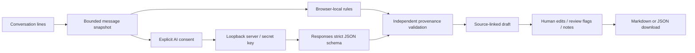

# Excerpts, uncertainty and a human review boundary

## Decisions

- **Extractive scope:** generated requirements must use exact source wording. That makes provenance mechanically checkable and keeps paraphrasing from quietly adding features. Humans can revise wording afterward; edits remain labeled.
- **Two honest engines:** the default rules work without an API key and are not marketed as a language model. Optional AI mode is a separate, consented server request. Failures are visible; there is no silent engine substitution.
- **Schema plus source validation:** structured JSON is necessary but does not prove a quote exists. Independent validation checks message IDs, quote substrings, source scope text and conservative commercial status. Model responses can still be incomplete in meaning or propose weak checks, so review remains necessary.
- **No automatic commercial reconciliation:** missing values remain unknown and competing statements remain conflicts. A later message is not treated as an approved change merely because of order.
- **Separate human metadata:** review flags and edited requirement text do not overwrite captured source. Markdown labels human changes. Changing the source invalidates export until regeneration.
- **Server-only credentials:** no keys in the frontend, URLs or public configuration response. Host/Origin checks protect browser mutations at the loopback boundary. The local server is not a public multi-tenant service.

## Local extraction limits

The local engine uses explicit Arabic/English request and exclusion patterns, known numeric currency/date cues and simple sentence/clause splitting. It deliberately skips question endings, missing-value phrases and instruction-like text. This is useful for repeatable drafts, not comprehensive semantic understanding. Its fixed evaluation fixtures cover known behaviors only.

## Provider contract

The adapter sends a Responses API request with strict JSON schema, no tools, an output-token limit, `store: false` and a timeout. It handles refusal, incomplete responses, HTTP failures and invalid provenance before accepting a `Brief`. Tests use mock provider envelopes plus a real local timeout. No live model-quality result is implied by these adapter tests. A custom provider must implement this same protocol.

## Privacy and operational boundary

Local mode performs no provider request. Explicit AI mode sends the captured conversation to the configured provider; account policies apply. Drafts are in memory, and exported files can contain sensitive content. The app does not automatically persist or contact third parties. Authentication, shared workspaces, retention management, distributed rate limiting and monitoring would be needed before operating a public AI service.
